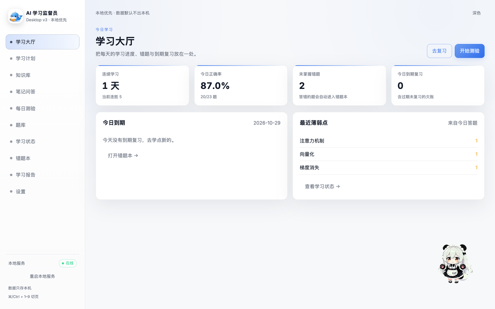
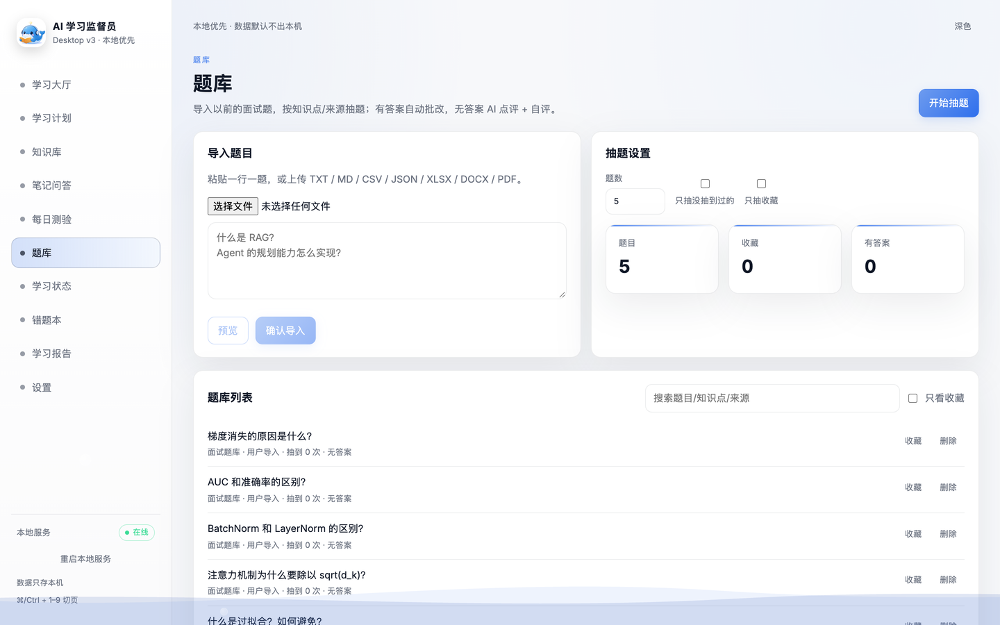
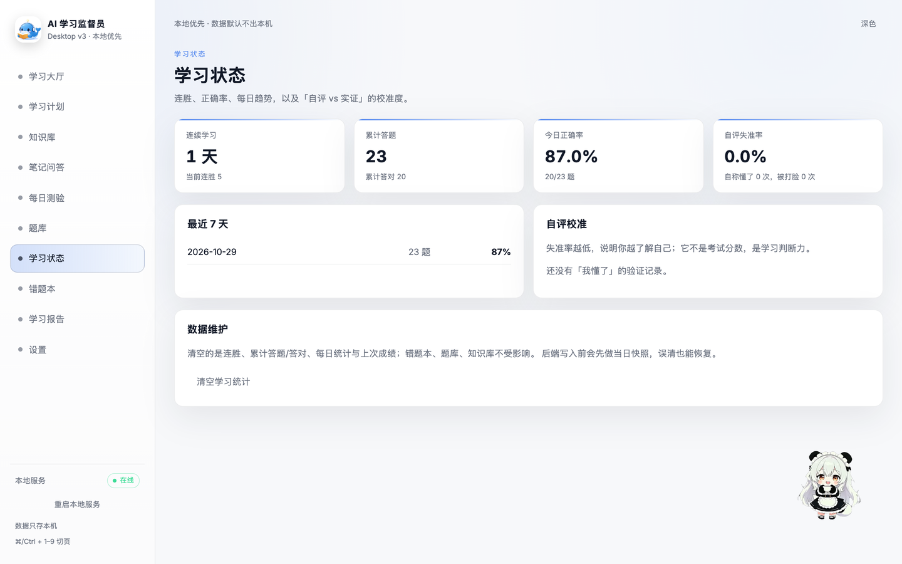

<div align="center">

# AI 学习监督员

**把笔记变成能问答、能出题、能批改的学习系统**

本地优先 · 数据不出本机 · 答案带出处 · 桌宠陪学

[**下载 Windows**](#windows-10--11) · [**下载 macOS**](#macos-apple-silicon) · [常见问题](#常见问题)

<sub>本仓库只发布成品，源代码不公开</sub>

</div>



> 截图使用软件内置的示例笔记，不含任何用户数据。

---

## 它解决什么问题

笔记记完就吃灰、复习没有节奏、做题不知道自己哪里不会——
它把这三件事接到一条链路上：

```
导入笔记 → 向量化 → 提问（带出处）→ 生成测验 → 自动批改 → 错题本 → 间隔复习
```

| | |
|---|---|
| **笔记问答** | 答案从**你自己的笔记**里检索，每条结论都标来源，可以追问 |
| **生成测验** | 按知识点出题（选择/判断/填空/简答），同卷不重复、题型严格按你勾的来 |
| **自动批改** | 客观题直接判分；主观题给评分要点，答错自动进错题本 |
| **错题本 + 复习** | 按遗忘曲线提醒重练，答对才算掌握 |
| **学习状态** | 连胜、正确率、薄弱知识点、"自评 vs 实证"的失准率 |
| **桌宠** | 一只会在你学习时待机、答错时安慰你的小助手（可关闭） |

<table>
<tr>
<td width="50%"></td>
<td width="50%"></td>
</tr>
<tr>
<td align="center"><sub>题库：批量导入、按知识点抽题、有答案自动批改</sub></td>
<td align="center"><sub>学习状态：连胜、正确率、薄弱点分布</sub></td>
</tr>
</table>

## 下载

<a id="windows-10--11"></a>

### Windows 10 / 11（64 位）

**[前往 Releases 下载 `AI-Study-Supervisor_x.y.z_x64-setup.exe`](../../releases/latest)**

1. 双击安装包
2. 若提示「Windows 已保护你的电脑」→ **更多信息** → **仍要运行**（未购买代码签名证书，不是病毒）
3. 启动后**先等 10~30 秒**：后端在预热，此时页面空白属正常
4. 打开 **设置** → 填供应商接口地址与 API Key → **保存并重启后端**
5. 打开 **知识库** → 导入笔记（PDF / Word / TXT / Markdown / CSV）

<a id="macos-apple-silicon"></a>

### macOS（Apple Silicon）

**[前往 Releases 下载 `AI-Study-Supervisor_x.y.z_aarch64.dmg`](../../releases/latest)**

1. 打开 DMG，把 App 拖进「应用程序」
2. 第一次打开：**右键 → 打开 → 打开**（未签名，双击会被 Gatekeeper 拦住）
3. 后续步骤同 Windows 第 4~5 步

> **需要自己准备大模型 Key**：软件本身不附带模型额度，按设置页提示填你自己的即可（智谱开放平台注册后创建，免费模型够用）。

## 你的数据在本地

- 笔记原文、向量库、错题本、学习记录**全部存在你的电脑上**，我们不做任何上报
- API Key 存在系统凭据管理器（Windows Credential Manager / macOS 钥匙串），不落明文
- 只有三处联网：调用你配置的模型服务商、检查更新（只读版本号）、首次运行下载本地向量模型
- 卸载不会自动删数据，彻底清除需要手动删除应用数据目录（设置页「诊断信息」里有完整路径）

## 系统要求

| 平台 | 要求 |
|---|---|
| Windows | Windows 10 1803+ / 11，需要 WebView2（Win11 自带） |
| macOS | 13.1+，Apple Silicon（M 系列） |
| 磁盘 | 约 1.2 GB（含本地向量模型） |

## 常见问题

<details>
<summary><b>为什么提示"未知发布者" / 打不开？</b></summary>

没有购买代码签名证书（个人项目）。Windows 点「更多信息 → 仍要运行」；macOS 右键 → 打开。
安装包完整性可与 Releases 说明里的 SHA-256 对照。
</details>

<details>
<summary><b>启动后一直是空白页？</b></summary>

后端还在预热（首次 10~30 秒）。超过 1 分钟仍空白：打开设置页找到日志路径，把 `sidecar.log` 发给作者。
</details>

<details>
<summary><b>问答一直转圈 / 没反应？</b></summary>

按顺序查两件事：① 设置页确认 Key 已保存、模型可用；② 知识库是否已导入笔记（空知识库会直接拦下问答）。
</details>

<details>
<summary><b>能完全离线用吗？</b></summary>

笔记检索是离线的（本地向量模型）；问答、出题、批改需要联网调用你配置的大模型。
</details>

<details>
<summary><b>怎么更新？</b></summary>

设置 →「关于与更新」→ 检查更新。也可以直接在本仓库 Releases 下载新版本覆盖安装，数据不会丢。
本仓库根目录的 `latest.json` 就是更新检查读取的版本清单。
</details>

## 反馈问题

遇到报错、卡住、显示异常，或者想提建议 → **[开一个 Issue](../../issues/new/choose)**。

模板会问你要四件事：**版本号、操作系统、复现步骤、期望与实际**。
如果方便，再贴一下 `sidecar.log` 的最后 20 行（位置在「设置 → 诊断信息」里）。

> ⚠️ 贴日志前请先删掉 API Key。正常日志里不该有完整 Key；万一贴出去了，
> 去智谱开放平台把那把 Key 删掉重建即可。

## 关于本仓库

- 这里**只放成品与版本清单**，不包含源代码
- 使用条款见 [LICENSE](LICENSE)：保留所有权利，仅限个人学习使用，禁止再分发与商用
- 第三方依赖与素材授权说明随安装包内文档提供